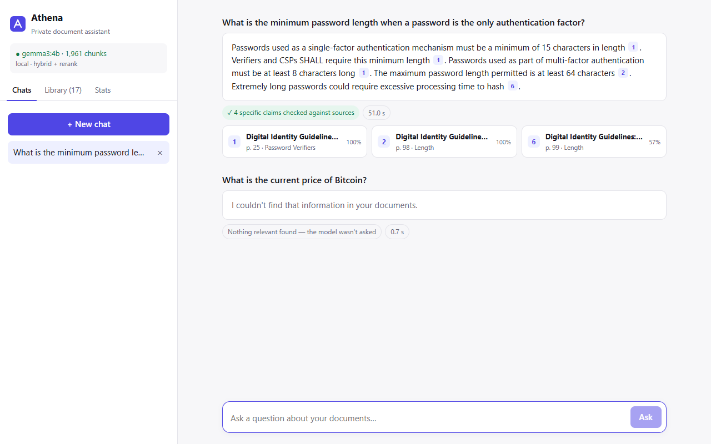
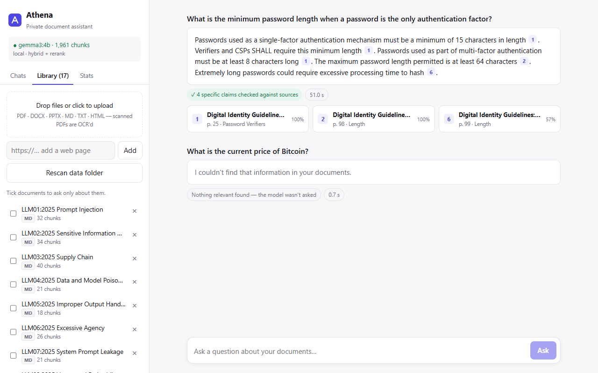
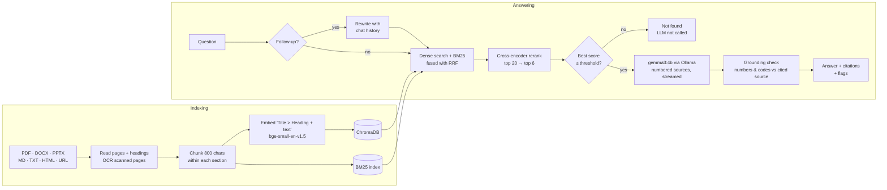

# Athena

**Ask your documents questions and get answers you can check.** Athena is a private
document assistant: every fact in an answer cites the file and page it came from, every
number in the answer is verified against that source, and when the documents don't
contain the answer it says so instead of guessing.

It runs **entirely on your computer**: a 4-billion-parameter model through Ollama, local
embeddings, a local reranker and local OCR. No API keys, no GPU, and no document ever
leaves the machine.

[](https://github.com/HEMANTHreddysolipeta/athena/actions/workflows/ci.yml)


| Every claim links to its source page | Not in the documents? It says so, in under a second |
|---|---|
|  |  |
| **Library: upload, add a URL, or scope questions** | **Live metrics from real use** |
|  |  |

**Measured on 61 questions over 17 public documents, fully offline on a laptop CPU:**
52/53 answers correct (53/53 on reading), the right document cited 53/53 times,
8/8 unanswerable questions refused, and hybrid search with reranking finds the exact
evidence passage among the top 6 in 29/34 cases vs 20/34 for embeddings alone. [Details ↓](#evaluation)

## What it does

| | |
|---|---|
| **Cited answers** | Every sentence cites its sources as `[1]`, `[2]`. Click a citation to see the exact passage, or the original PDF page. |
| **Grounding check** | Numbers, versions, codes and acronyms in the answer must appear in the cited source. If the model writes "28" and the page says "31", the answer is flagged. |
| **Honest "not found"** | If nothing relevant is retrieved, Athena says so *without calling the model at all*; otherwise the model is instructed to answer only from the sources. |
| **Hybrid search + reranking** | Keyword search (BM25) catches exact terms like "AAL2" or "800-63B"; embeddings catch paraphrases; a cross-encoder reranks the shortlist. |
| **Any document** | PDF, DOCX, PPTX, Markdown, TXT, HTML and web pages by URL. Scanned PDFs are OCR'd locally. |
| **Follow-up questions** | "What about AAL3?" is rewritten into a standalone question using the chat history. |
| **Streaming** | The first words appear in a few seconds on a CPU instead of after the full 20–30 s. |
| **Scoped questions** | Tick documents in the library to ask only about them. |
| **Measured** | A 61-question eval set, a retrieval quality gate in CI, and a live metrics panel (latency, tokens, grounded vs flagged answers). |

## How it works



## Evaluation

All numbers below are reproducible: the documents ship in [`demo_corpus/`](demo_corpus/SOURCES.md)
(public-domain NIST publications, the OWASP Top 10 for LLM Applications, two Wikipedia
articles and a scanned PDF), and the questions are in
[`backend/eval/demo_questions.jsonl`](backend/eval/demo_questions.jsonl).

**The eval set: 61 questions.** 53 answerable (facts, exact numbers, exact terms,
12 deliberately paraphrased questions that share few words with the answer, a question
answerable only from the scanned PDF, and multi-document questions) and 8 unanswerable
ones. Every question carries an evidence quote; [`build_questions.py`](backend/eval/build_questions.py)
proves each quote is really in the expected document and records its page, so no expected
page was typed from memory.

**Metrics.** *File* and *page*: is the right document/page among the results. The strictest
is *passage*: does a returned chunk contain the exact evidence sentence (34 questions have
a quote specific enough to score this).

#### Retrieval (k = 6, 1,961 chunks, CPU)

| Embedding | Search | File @1 | Page in top 6 | Passage first | Passage in top 6 | Time |
|---|---|---|---|---|---|---|
| all-MiniLM-L6-v2 | dense only | 50/53 | 26/38 | 8/34 | 17/34 | 33 ms |
| all-MiniLM-L6-v2 | hybrid + rerank | 52/53 | 31/38 | 19/34 | 24/34 | 0.8 s |
| bge-small-en-v1.5 | dense only | 52/53 | 30/38 | 13/34 | 20/34 | 47 ms |
| bge-small-en-v1.5 | keyword only (BM25) | 50/53 | 28/38 | 16/34 | 22/34 | 1 ms |
| bge-small-en-v1.5 | hybrid (RRF) | 52/53 | 28/38 | 14/34 | 21/34 | 48 ms |
| **bge-small-en-v1.5** | **hybrid + rerank** (default) | **52/53** | **34/38** | **21/34** | **29/34** | 0.8 s |

Reranking more than doubles how often the exact passage comes first compared with
embeddings alone (8 → 19 with MiniLM, 13 → 21 with BGE). Finding the right *file* is easy
on this corpus, since each document has its own topic; finding the right *passage* is where
the designs differ. CI rebuilds this index and fails if "passage in top 6" drops below 26.

#### Answers (gemma3:4b on a laptop CPU, i5-1335U, no GPU)

| | Result |
|---|---|
| Answerable questions answered correctly (automatic keyword check) | **52 / 53** |
| …after reading the one miss | 53 / 53: it said "require user approval"; the check wanted the word "human" |
| A cited source is the right document | **53 / 53** |
| Passed the grounding check | **51 / 53**: one real catch (a citation to a source `[7]` that didn't exist), one false alarm ("two types" read as the number 2) |
| Unanswerable questions refused | **8 / 8**, 4 of them in ~1 s without calling the model |
| Time per answer | median **46 s**, 90th percentile 65 s (first words stream after the prompt is read, ~15–20 s) |

Where the time goes on this CPU: reading the ~640-token prompt takes ~20 s (~30 tokens/s),
writing a ~90-token answer ~12 s. `ATHENA_TOP_K=4` cuts prompt reading by ~45% at the cost
of finding the exact passage less often (26 vs 29 of 34); `ATHENA_LLM_THREADS=8` read
prompts ~25% faster on this machine. The model stays loaded between questions and is
pre-loaded when the server starts, because reloading it costs another 15–20 s.

One eval question was itself wrong and got replaced: "Who is the current director of
NIST?" was meant to be unanswerable, but the NIST documents name the director on their
cover pages, so the model answered it correctly with a citation.

### Findings worth knowing

- **The eval found three real bugs**, each invisible in a demo:
  1. *Glued words.* NIST AI 100-1 positions every word separately with no space characters,
     so text came out as `notallincidentsandfailures`. The reader now rebuilds lines from
     character positions and inserts spaces at visible gaps.
  2. *Ligatures.* NIST PDFs encode "fi" as one character (`fi`), so a search for
     "confidently" never matched "confidently". All text is NFKC-normalised.
  3. *Negative keyword weights.* Classic BM25 (Okapi IDF) gives a word that occurs in more
     than half the chunks a weight ≤ 0, so in a small personal library a *matching* word
     could push a chunk down. Athena uses Lucene's always-positive IDF in its own small
     BM25 over an inverted index.
- **The reranker is the biggest single win**: it finds the exact passage first far more
  often than any retriever alone, at the cost of ~1.5 s on a CPU.
- **Fair comparisons only.** Bigger chunks look better at a fixed *k* simply because they
  contain more text. At the same amount of context (4,800 characters), six 800-character
  chunks beat four 1,200-character ones.
- **Abstaining early.** The reranker's best score separates "nothing relevant" well enough
  that the clearly-unanswerable questions (Bitcoin price, a biryani recipe) are refused in
  about a second without calling the model. The threshold (−6.0) was set so that *no*
  answerable question in the eval is refused; borderline cases still go to the model,
  which can answer NOT_FOUND itself.

### Limits

- 61 questions on 17 documents is enough to compare designs and catch regressions, not a
  benchmark. The answer metric uses keyword matching, which is strict but crude.
- The grounding check verifies *specific tokens* (numbers, codes, acronyms), not the
  meaning of every sentence. A wrong paraphrase with no numbers in it is not caught.
- On a CPU, an answer takes ~20–30 s (streaming shows the first words after a few).

## Run it

### Option A: Docker (one command)

```bash
docker compose up -d        # first run downloads the model (~3.3 GB)
```

Open **http://127.0.0.1:8000**, then upload documents in the Library tab (or put them in
`./data` and click *Rescan data folder*).

### Option B: Python + Node

Requirements: Python 3.13, Node 22, and [Ollama](https://ollama.com) with
`ollama pull gemma3:4b`.

```bash
python -m venv .venv
.venv\Scripts\python.exe -m pip install -r backend\requirements-dev.txt   # macOS/Linux: .venv/bin/python
cd frontend && npm ci && npm run build && cd ..

cd backend
..\.venv\Scripts\python.exe -m uvicorn app:app          # http://127.0.0.1:8000
```

The embedding (~130 MB) and reranker (~90 MB) models download once on first use, then
work offline.

### Command line

```bash
cd backend
..\.venv\Scripts\python.exe -m athena.index_folder                      # index ../data
..\.venv\Scripts\python.exe -m athena.ask "What is the minimum password length?" --show-context
..\.venv\Scripts\python.exe -m pytest                                   # unit + API tests
..\.venv\Scripts\python.exe eval\run_eval.py retrieval --modes all      # search comparison (minutes)
..\.venv\Scripts\python.exe eval\run_eval.py answers                    # full answer eval (~40 min on CPU)
```

Chat commands (slash only, so a question starting with "find" is still a question):
`/find`, `/read`, `/open`, `/remember key = value`, `/recall`, `/help`.

## Configuration

Every setting is an environment variable (or a line in `backend/.env`); see
[`athena/config.py`](backend/athena/config.py). The useful ones:

| Variable | Default | |
|---|---|---|
| `ATHENA_LLM_MODEL` | `gemma3:4b` | Any Ollama model. qwen3:4b was measured at 265–1,065 output tokens for a one-sentence answer (it keeps reasoning); gemma3:4b used ~35. |
| `ATHENA_EMBEDDING_MODEL` | `BAAI/bge-small-en-v1.5` | Each model gets its own collection, so switching never mixes vectors. |
| `ATHENA_RETRIEVAL_MODE` | `hybrid` | `dense`, `keyword` or `hybrid` |
| `ATHENA_RERANK` | `true` | Cross-encoder reranking of the fused shortlist |
| `ATHENA_TOP_K` | `6` | Chunks given to the model |
| `ATHENA_MIN_RERANK_SCORE` | `-6.0` | Below this, answer "not found" without calling the model |
| `ATHENA_DATA_DIR` | `data/` | Your documents |
| `ATHENA_API_KEY` | *(unset)* | If set, every API call needs an `X-API-Key` header |

## Security and privacy

- **Local only.** The API binds to `127.0.0.1` (Docker publishes it on `127.0.0.1` only).
  No telemetry; models are downloaded once and then used offline.
- **Your documents are never committed.** `data/`, indexes and the database are git-ignored.
- **Adding a web page can't reach your network.** URL import allows only http/https,
  refuses any host that resolves to a private, loopback or link-local address (checked
  again on every redirect), and caps size and time.
- **File commands are confined** to the data folder: `/open` refuses executables, `..`
  traversal and anything outside `data/`. Uploads are renamed to a safe name, limited in
  type and size.
- **Rate limit** on questions (each one runs the CPU flat out), optional API key.

## Project layout

```
backend/
  app.py                 FastAPI: streaming chat, documents, conversations, metrics; serves the UI
  athena/
    document_reader.py   every format -> sections (page, heading, text); OCR fallback
    chunker.py           section-aware chunks; title > heading context for embedding
    retriever.py         BM25 + dense + RRF + cross-encoder rerank + abstention
    rag.py               follow-up rewrite, prompt, streaming, citations
    grounding.py         checks numbers/codes/acronyms against the cited sources
    web.py               safe URL import (SSRF-guarded)
  eval/                  questions, builder, runner, quality gate
  tests/                 unit and API tests (fake embedder; no models needed)
frontend/                React + TypeScript + Vite UI
demo_corpus/             openly licensed documents for the reproducible eval
```

## License

Code: [MIT](LICENSE). The documents in `demo_corpus/` keep their own licenses
(public domain and CC BY-SA 4.0); see [SOURCES.md](demo_corpus/SOURCES.md).
