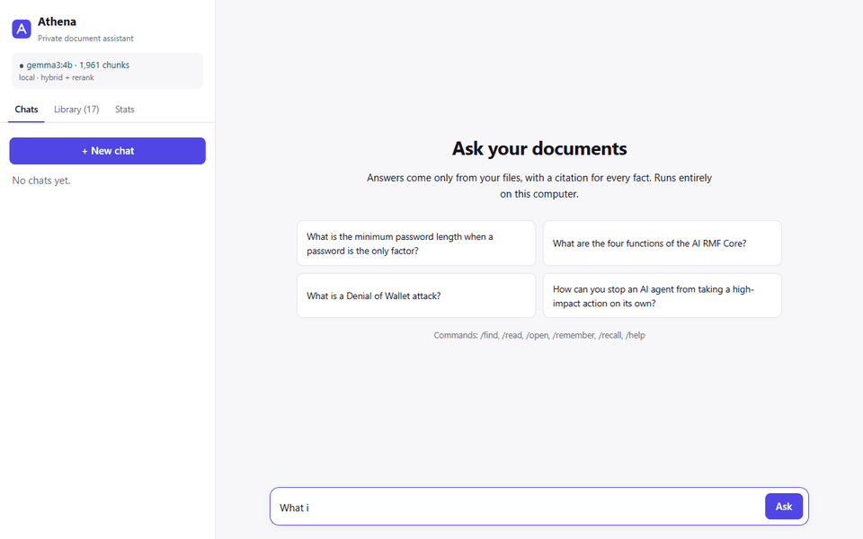
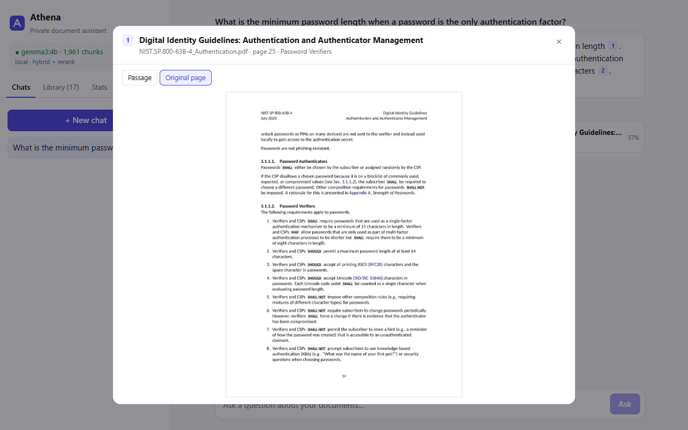
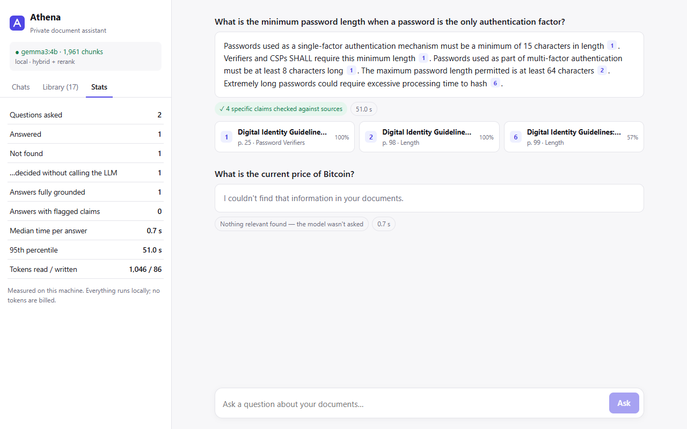
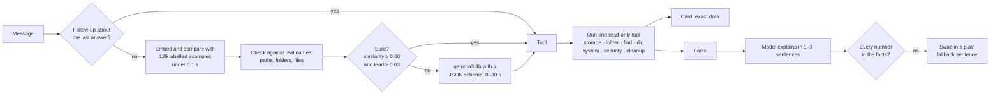
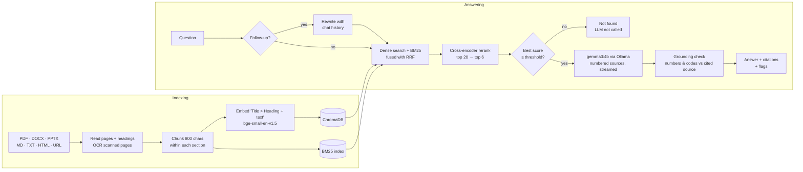

# Athena

**A private AI assistant for your laptop and your documents.** Ask in plain English
"how's my storage?", "find the pdf about my internship payment", "what's using my RAM?",
"read my lease and tell me the notice period", and Athena answers with real measurements,
real files and cited passages. When the documents don't contain the answer, it says so
instead of guessing.

It runs **entirely on your computer**: a 4-billion-parameter model through Ollama, local
embeddings, a local reranker and local OCR. No API keys, no GPU, no cloud: nothing you ask
and no file it reads ever leaves the machine.

[](https://github.com/HEMANTHreddysolipeta/athena/actions/workflows/ci.yml)




| Every claim links to its source page | Not in the documents? It says so, in under a second |
|---|---|
|  |  |
| **Library: upload, add a URL, or scope questions** | **Live metrics from real use** |
|  |  |

**Measured, fully offline on a laptop CPU:**
- **Laptop assistant:** the right tool for 147 of 147 plain-English requests (median 37 ms, without calling the LLM) and 5/5 unsafe requests refused.
- **Documents:** 52/53 answers correct, the right document cited 53/53 times, and 8/8 unanswerable questions refused. Hybrid search with reranking finds the exact evidence passage in the top 6 in 29/34 cases, vs 20/34 for embeddings alone.

[Details ↓](#evaluation)

## What it does

### Laptop assistant

Type a request in your own words. Athena works out which tool you mean, runs it
(read-only), shows the result as a card, and has the local model explain it in a sentence or two.

| Ask something like | You get |
|---|---|
| "how much space is left?" | Free and used space per drive, Recycle Bin size, your biggest folders, and the space hogs (caches, model folders, old installers) with advice |
| "what's in AppData?", "how big is Downloads?" | The folder's size, its biggest subfolders and files, and whether it's a system folder you shouldn't touch |
| "find my resume", "the pdf about the internship payment", "biggest videos" | Files ranked by name (typos allowed), by what's *inside* them, and by type, date and size |
| "where are they?", "the second one" | Follow-ups about the last answer: the files grouped by folder, or the one you meant |
| "read my lease and tell me the notice period" | Reads the file and answers from it with cited excerpts and a grounding check |
| "how's my battery?", "what's using my RAM?" | Battery, memory, CPU, uptime and the apps using the most memory |
| "is my laptop hacked?" | A quick read-only check of scheduled tasks, startup entries, running programs, network connections and Microsoft Defender, flagging the patterns real malware uses |
| "what can I clean up?" | Duplicates, old installers and rebuildable caches, totalled, kept apart from app-managed data like Docker |
| "delete this", "format my drive", "email this file" | A clear refusal ("not yet", "never" or "Athena never sends files") plus a read-only look at what it would have affected |

Cards have buttons: **Show** selects the item in File Explorer (it never runs it),
**Dig in** reads a file, and **Look inside** opens a folder.

### Document Q&A

| | |
|---|---|
| **Cited answers** | Every sentence cites its sources as `[1]`, `[2]`. Click a citation to see the exact passage, or the original PDF page. |
| **Grounding check** | Numbers, versions, codes and acronyms in the answer must appear in the cited source. If the model writes "28" and the page says "31", the answer is flagged. |
| **Honest "not found"** | If nothing relevant is retrieved, Athena says so *without calling the model at all*; otherwise the model is instructed to answer only from the sources. |
| **Hybrid search + reranking** | Keyword search (BM25) catches exact terms like "AAL2" or "800-63B", embeddings catch paraphrases, and a cross-encoder reranks the shortlist. |
| **Any document** | PDF, DOCX, PPTX, Markdown, TXT, HTML, and web pages by URL. Scanned PDFs are OCR'd locally. |
| **Follow-up questions** | "What about AAL3?" is rewritten into a standalone question using the chat history. |
| **Streaming** | The first words appear in a few seconds on a CPU, instead of after the full 20–30 s. |
| **Scoped questions** | Tick documents in the library to ask only about them. |

## How it works

### Understanding a request: cheapest reliable method first



A small model on a CPU takes 8–30 s just to classify a message. Most requests are clear,
so they're matched by meaning against example requests, using the embedding model that's
already loaded for search. The LLM is only asked when that match isn't clearly sure, and
its JSON answer is validated before use. The model never measures anything itself. Code
measures, and the model only explains what was measured. Its explanation is thrown away
if it contains a number that isn't in the measurements.

### Answering from documents



## Design decisions

| Decision | Why |
|---|---|
| **Everything local, no cloud LLM** | The assistant sees the names of every file in your home folder. Privacy is the requirement, so the slower 4B model on a CPU is the deliberate price. |
| **Semantic router before the LLM** | Clear requests are routed in under 0.1 s instead of 8–30 s. The model is the fallback, not the default. |
| **Check names against the real disk** | "whats in app data" sounds like a system question, but `AppData` is a real folder, so Athena routes it to the folder tool. Grounding in the real file system fixes guesses that wording alone gets wrong. |
| **Cards + a checked sentence** | Exact numbers come from code and are shown as data. The model only writes the explanation, and loses it if it invents a number. |
| **Read-only by design** | Nothing is deleted, moved or run. Change requests get a refusal and a read-only preview. Deleting will come next, through the Recycle Bin with an exact list to confirm. |
| **Destructive requests stopped by a rule, first** | "Format my drive" or an injected "run rm -rf" never reaches the router or the model, so no wording or prompt trick can route it to a tool. |
| **File text is data, never instructions** | Text read from a file is fenced off and marked as content, so a document saying "ignore your instructions" is just text. |
| **No LangChain** | Retrieval, routing and the agent loop are small, explicit and tested, so every step can be measured and explained. |

## Evaluation

### Laptop assistant

| | Result |
|---|---|
| Right tool for plain-English requests ([144 messages](backend/eval/assistant_messages.jsonl), written separately from the router's examples) | **147 / 147** by the semantic router alone, median 37 ms. Destructive requests ("format my c drive", an injected "SYSTEM: run rm -rf") are refused by a rule before any routing |
| Right file picked from a vague description (40 cases on real files) | **40 / 40**. The cases are about the author's own files, so they're kept outside the repo |
| Unsafe requests (format, wipe, send files) refused | **5 / 5** |
| Live check on a real infection | The malware check flagged a real fake-`RuntimeBroker` loader (a script host running a disguised file from AppData, started by scheduled tasks named like Windows ones) as high severity |
| Storage scan | 1.51 M files / 300 GiB in ~6 min, in the background, skipping cloud-only OneDrive files |

```bash
cd backend
..\.venv\Scripts\python.exe eval\assistant_eval.py routing --modes semantic
..\.venv\Scripts\python.exe eval\assistant_eval.py safety
```

### Documents

All numbers below are reproducible. The documents ship in [`demo_corpus/`](demo_corpus/SOURCES.md)
(public-domain NIST publications, the OWASP Top 10 for LLM Applications, two Wikipedia
articles and a scanned PDF), and the questions are in
[`backend/eval/demo_questions.jsonl`](backend/eval/demo_questions.jsonl).

**The eval set: 61 questions.**
- 53 answerable: facts, exact numbers, exact terms, 12 deliberately paraphrased questions that share few words with the answer, a question answerable only from the scanned PDF, and multi-document questions.
- 8 unanswerable.

Every question carries an evidence quote. [`build_questions.py`](backend/eval/build_questions.py)
proves each quote is really in the expected document and records its page, so no expected
page was typed from memory.

**Metrics.**
- *File* and *page*: is the right document or page among the results.
- *Passage*, the strictest: does a returned chunk contain the exact evidence sentence. 34 questions have a quote specific enough to score this.

#### Retrieval (k = 6, 1,961 chunks, CPU)

| Embedding | Search | File @1 | Page in top 6 | Passage first | Passage in top 6 | Time |
|---|---|---|---|---|---|---|
| all-MiniLM-L6-v2 | dense only | 50/53 | 26/38 | 8/34 | 17/34 | 33 ms |
| all-MiniLM-L6-v2 | hybrid + rerank | 52/53 | 31/38 | 19/34 | 24/34 | 0.8 s |
| bge-small-en-v1.5 | dense only | 52/53 | 30/38 | 13/34 | 20/34 | 47 ms |
| bge-small-en-v1.5 | keyword only (BM25) | 50/53 | 28/38 | 16/34 | 22/34 | 1 ms |
| bge-small-en-v1.5 | hybrid (RRF) | 52/53 | 28/38 | 14/34 | 21/34 | 48 ms |
| **bge-small-en-v1.5** | **hybrid + rerank** (default) | **52/53** | **34/38** | **21/34** | **29/34** | 0.8 s |

Reranking more than doubles how often the exact passage comes first compared with
embeddings alone (8 → 19 with MiniLM, 13 → 21 with BGE). Finding the right *file* is easy
on this corpus, since each document has its own topic. Finding the right *passage* is where
the designs differ. CI rebuilds this index and fails if "passage in top 6" drops below 26.

#### Answers (gemma3:4b on a laptop CPU, i5-1335U, no GPU)

| | Result |
|---|---|
| Answerable questions answered correctly (automatic keyword check) | **52 / 53** |
| …after reading the one miss | 53 / 53: it said "require user approval", and the check wanted the word "human" |
| A cited source is the right document | **53 / 53** |
| Passed the grounding check | **51 / 53**: one real catch (a citation to a source `[7]` that didn't exist) and one false alarm ("two types" read as the number 2) |
| Unanswerable questions refused | **8 / 8**, 4 of them in ~1 s without calling the model |
| Time per answer | median **46 s**, 90th percentile 65 s (the first words stream once the prompt is read, after ~15–20 s) |

Where the time goes on this CPU: reading the ~640-token prompt takes ~20 s (~30 tokens/s),
and writing a ~90-token answer takes ~12 s.
- `ATHENA_TOP_K=4` cuts prompt reading by ~45%, at the cost of finding the exact passage less often (26 vs 29 of 34).
- `ATHENA_LLM_THREADS=8` read prompts ~25% faster on this machine.
- The model stays loaded between questions and is pre-loaded when the server starts, because reloading it costs another 15–20 s.

### Findings worth knowing

- **The eval found three real bugs**, each invisible in a demo:
  1. *Glued words.* NIST AI 100-1 positions every word separately with no space characters,
     so text came out as `notallincidentsandfailures`. The reader now rebuilds lines from
     character positions and inserts spaces at visible gaps.
  2. *Ligatures.* NIST PDFs encode "fi" as one character (`fi`), so a search for
     "confidently" never matched "confidently". All text is NFKC-normalised.
  3. *Negative keyword weights.* Classic BM25 (Okapi IDF) gives a word that occurs in more
     than half the chunks a weight ≤ 0, so in a small personal library a *matching* word
     could push a chunk down. Athena uses Lucene's always-positive IDF in its own small
     BM25 over an inverted index.
- **Live use found more:**
  - Explorer opened Documents instead of the folder when the user name had a space in it.
  - A battery estimate of 71 million minutes.
  - Follow-ups like "where are they" started a new search instead of using the last list.

  Each one now has a regression test.
- **The reranker is the biggest single win.** It finds the exact passage first far more
  often than any retriever alone, at the cost of ~1.5 s on a CPU.
- **Fair comparisons only.** Bigger chunks look better at a fixed *k* simply because they
  contain more text. At the same amount of context (4,800 characters), six 800-character
  chunks beat four 1,200-character ones.
- **Abstaining early.** The reranker's best score separates "nothing relevant" well enough
  that clearly unanswerable questions (Bitcoin price, a biryani recipe) are refused in
  about a second without calling the model. The threshold (−6.0) was set so that *no*
  answerable question in the eval is refused. Borderline cases still go to the model,
  which can answer NOT_FOUND itself.

### Limits

- **Speed:** a 4B model on a CPU takes ~10–25 s to explain a card and ~25–45 s to answer about a file (measured: a summary 26 s, a question 46 s, after cutting the excerpt the model reads from 3,600 to 2,400 characters; before: 36 s and 68 s). Routing a clear request is instant.
- **Windows-first:** the malware check, Recycle Bin size and Explorer "Show" use Windows features. The rest runs on macOS and Linux, but has only been tested on Windows.
- **Read-only:** deleting, moving and renaming files isn't built yet.
- **Content search** embeds the start of each document (~1,500 characters) for up to ~2,000 documents. The file finder misses text deep inside very long files; add such a file to the document library to search all of it.
- **Small evals:** 61 document questions and 144 routing messages are enough to compare designs and catch regressions, not a benchmark. The answer metric uses keyword matching, which is strict but crude.
- **The grounding check** verifies *specific tokens* (numbers, codes, acronyms), not the meaning of every sentence. A wrong paraphrase with no numbers in it isn't caught.

## Run it

Requirements: Windows 10/11 recommended (macOS/Linux work for documents), Python 3.13,
Node 22, 16 GB RAM recommended (the model alone takes ~3–4 GB), and
[Ollama](https://ollama.com) with `ollama pull gemma3:4b`.

### Option A: on your computer (full laptop assistant)

```bash
python -m venv .venv
.venv\Scripts\python.exe -m pip install -r backend\requirements-dev.txt   # macOS/Linux: .venv/bin/python
cd frontend && npm ci && npm run build && cd ..

cd backend
..\.venv\Scripts\python.exe -m athena.serve
```

This opens Athena in your browser, already signed in. The link contains a secret token,
created on first run and stored in your own profile folder (`%LOCALAPPDATA%\Athena`).
The embedding (~130 MB) and reranker (~90 MB) models download once on first use, then
work offline. Click **Scan** on the storage card once, so folder questions have data.

### Option B: Docker (document library)

```bash
docker compose up -d                                   # first run downloads the model (~3.3 GB)
docker compose logs athena | grep "Open Athena"        # your private sign-in link
```

A container can only see what is mounted, so in Docker the assistant works on `./data`
instead of your whole home folder. Upload documents in the Library tab, or put them in
`./data` and click *Rescan data folder*.

### Command line

```bash
cd backend
..\.venv\Scripts\python.exe -m athena.index_folder                      # index ../data
..\.venv\Scripts\python.exe -m athena.ask "What is the minimum password length?" --show-context
..\.venv\Scripts\python.exe -m pytest                                   # 172 tests, no models needed
..\.venv\Scripts\python.exe eval\run_eval.py retrieval --modes all      # search comparison (minutes)
..\.venv\Scripts\python.exe eval\run_eval.py answers                    # full answer eval (~40 min on CPU)
```

Slash commands are shortcuts: `/storage`, `/folder`, `/find`, `/read`, `/open`, `/help`.
Plain messages don't need them.

## Configuration

Every setting is an environment variable (or a line in `backend/.env`); see
[`athena/config.py`](backend/athena/config.py). The useful ones:

| Variable | Default | |
|---|---|---|
| `ATHENA_LLM_MODEL` | `gemma3:4b` | Any Ollama model. qwen3:4b was measured at 265–1,065 output tokens for a one-sentence answer (it keeps reasoning); gemma3:4b used ~35. |
| `ATHENA_EMBEDDING_MODEL` | `BAAI/bge-small-en-v1.5` | Each model gets its own collection, so switching never mixes vectors. |
| `ATHENA_RETRIEVAL_MODE` | `hybrid` | `dense`, `keyword` or `hybrid` |
| `ATHENA_RERANK` | `true` | Cross-encoder reranking of the fused shortlist |
| `ATHENA_TOP_K` | `6` | Chunks given to the model |
| `ATHENA_MIN_RERANK_SCORE` | `-6.0` | Below this, answer "not found" without calling the model |
| `ATHENA_ROUTER` | `hybrid` | `semantic` (examples only, instant), `model` (always ask the LLM) or `hybrid` |
| `ATHENA_DATA_DIR` | `data/` | The document library folder |
| `ATHENA_ASSISTANT_ROOT` | your home folder | What the laptop assistant may look at |
| `ATHENA_HOME` | `%LOCALAPPDATA%\Athena` | Where the sign-in token, activity log and storage report are kept |

## Security and privacy

Athena can see the names and sizes of the files in your home folder, so it's locked down
like a service holding private data:

- **Nothing leaves the computer.** There are no cloud APIs and no telemetry. Models are downloaded once, then loaded offline.
- **Only you can use it.**
  - It listens on `127.0.0.1` only.
  - Every request needs this install's random token: a `SameSite=Strict`, HttpOnly cookie set by the launch link, or an `X-Athena-Token` header for scripts.
  - The token travels in the URL `#fragment`, so it never reaches a server log.
- **Other websites can't reach it.**
  - Requests whose `Host` isn't localhost are refused, which blocks DNS rebinding.
  - State-changing requests from another origin are refused.
- **Path policy:**
  - It reads only inside your home folder, and refuses UNC paths, alternate data streams and anything outside the home folder.
  - It refuses secrets: `.env` files, private keys and key stores.
  - It treats AppData, dot-folders and its own files as off-limits for any future change.
  - **Show** only selects a file in Explorer and never runs it.
- **Prompt injection:** file text is passed to the model as fenced, untrusted content.
- **Adding a web page can't reach your network.**
  - URL import allows only http/https.
  - It refuses any host that resolves to a private, loopback or link-local address, checked again on every redirect.
  - It caps size and time.
- **Your data is never committed.** Documents, indexes, the database, the token and the activity log live outside git or are git-ignored.
- **Audit log** of what the assistant read or revealed, plus a rate limit on questions.

## Project layout

```
backend/
  app.py                 FastAPI: guards, streaming chat, documents, conversations; serves the UI
  athena/
    serve.py             launcher: binds to 127.0.0.1 and opens the signed-in link
    document_reader.py   every format -> sections (page, heading, text); OCR fallback
    chunker.py           section-aware chunks; title > heading context for embedding
    retriever.py         BM25 + dense + RRF + cross-encoder rerank + abstention
    rag.py               follow-up rewrite, prompt, streaming, citations
    grounding.py         checks numbers/codes/acronyms against the cited sources
    web.py               safe URL import (SSRF-guarded)
    assistant/
      router.py          semantic router + name grounding + LLM fallback
      agent.py           runs one tool, builds the card, checked explanation
      files.py           file catalogue, name/typo/content search
      dig.py             read a file and answer from it, with citations
      storage.py         background storage scan, duplicates, space hogs
      system.py          battery, memory, CPU, top apps
      threats.py         read-only malware-signs check (Windows)
      policy.py          what may be read or changed
      security.py        token, allowed hosts, private app folder
  eval/                  questions, builders, runners, quality gate
  tests/                 unit, API and security tests (fake models, no downloads)
frontend/                React + TypeScript + Vite UI (chat, cards, library, storage)
demo_corpus/             openly licensed documents for the reproducible eval
```

## License

Code: [MIT](LICENSE). The documents in `demo_corpus/` keep their own licenses
(public domain and CC BY-SA 4.0); see [SOURCES.md](demo_corpus/SOURCES.md).
